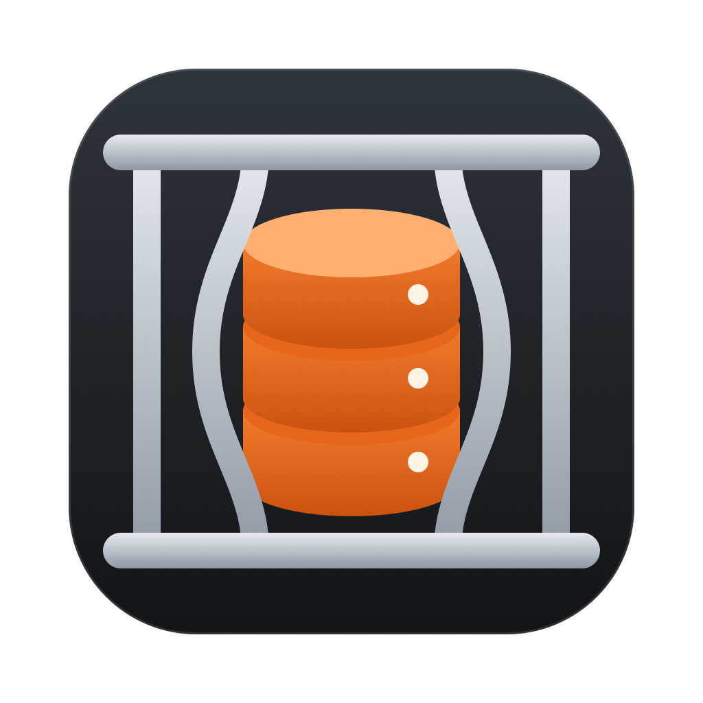

<p align="center"></p>

# FreeMyMac

A native macOS storage manager. It shows where your disk space went, and removes what you choose in one or two clicks.

## Install

Needs macOS 26 or later on Apple silicon.

1. Download the zip from the [latest release](https://github.com/GWPx7Pavitra/freemymac/releases/latest) and unzip it.
2. Move `FreeMyMac.app` to Applications.
3. Open it. The app isn't notarized by Apple, so the first time macOS blocks it. Go to **System Settings > Privacy & Security**, scroll down, and click **Open Anyway**.

## Build from source

Needs only Apple's Command Line Tools. Full Xcode isn't required.

```bash
./build.sh
```

```bash
open dist/FreeMyMac.app
```

To copy it to `~/Applications`:

```bash
./build.sh --install
```

## First run: turn on Full Disk Access

Without it, macOS hides Mail, Messages, Photos, the Trash, and every app's private container, so most of your disk looks like a mystery. FreeMyMac shows a button that opens the right Settings page.

The app is signed locally, so **rebuilding it changes its identity**, and macOS may ask you to grant access again.

## How deleting works

| What | What happens | Asks first? |
| --- | --- | --- |
| Caches, logs, old Homebrew versions | Removed permanently. They rebuild themselves. | Free Up and Clean Selected ask, until you tick "Don't ask again". A row's own Clean button doesn't ask. |
| Your own files | Removed permanently by default. Switch to the Trash in Settings. | Yes, until you tick "Don't ask again" |
| Emptying the Trash | Removed permanently | Always |
| Files you don't own | One macOS password prompt, then removed. FreeMyMac never sees the password. | Always |

Apps that are open are skipped, and this is checked again at the moment of cleaning.

FreeMyMac doesn't keep a root process or a saved password. Administrator rights are requested per action and end with that one command.

### What's always protected

`SafetyGuard` is checked before anything is removed, on every screen. It allows only specific locations and refuses everything else, including:

- macOS system folders
- Keychains, SSH, GPG, and cloud credentials
- Mail, Messages, Safari, and the Photos library
- iCloud Drive and other synced folders, because deleting there deletes everywhere
- Top-level folders like Documents and Library
- Anything inside an app bundle

Symlinks are removed as links, never followed. Every removal is logged to `~/Library/Logs/FreeMyMac/activity.log`, which you can open from the Storage menu.

## Trying it safely

With `FREEMYMAC_HOME` set, FreeMyMac scans and deletes only inside that folder, and keeps separate settings.

```bash
scripts/make-test-home.sh /tmp/freemymac-test
```

```bash
open -n --env FREEMYMAC_HOME=/tmp/freemymac-test dist/FreeMyMac.app
```

## Tests

```bash
./test.sh
```

## Layout

- `Sources/FreeMyMacCore`: the scanner, cleanup catalog, safety guard, and deletion. No UI.
- `Sources/FreeMyMac`: the SwiftUI app.
- `Tests/FreeMyMacCoreTests`: tests that only delete inside throwaway folders.

## License

[MIT](LICENSE)
